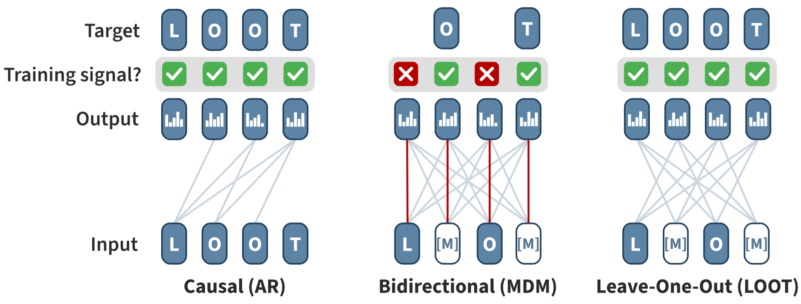
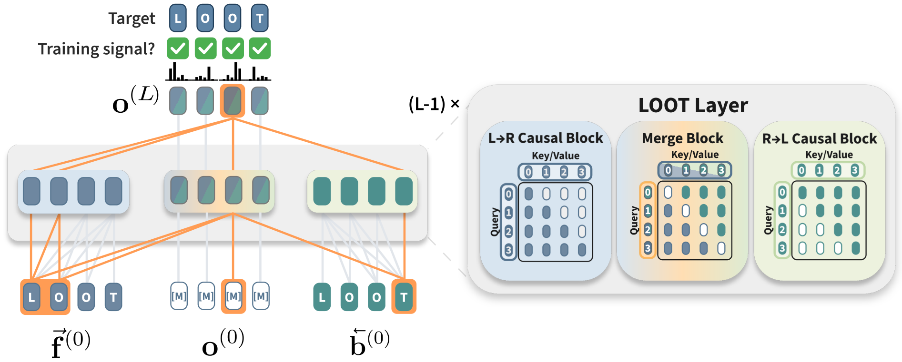
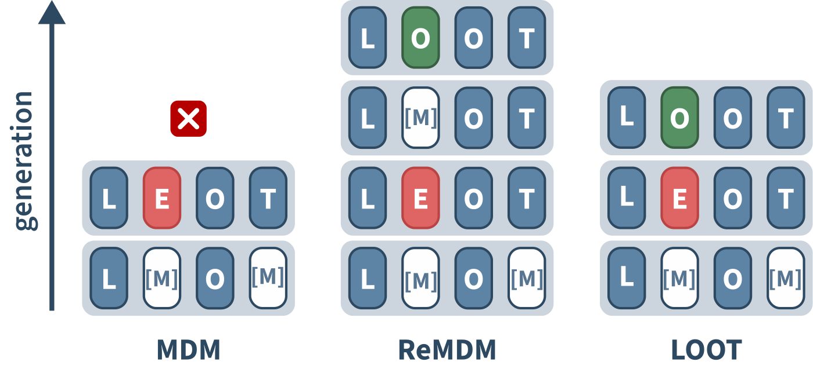
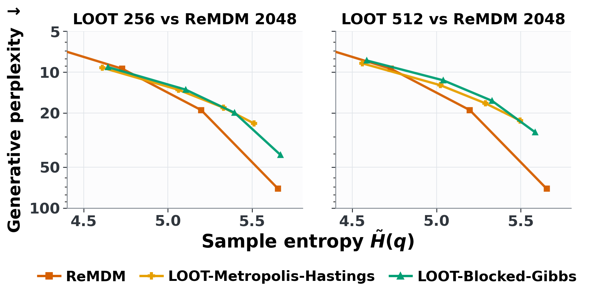
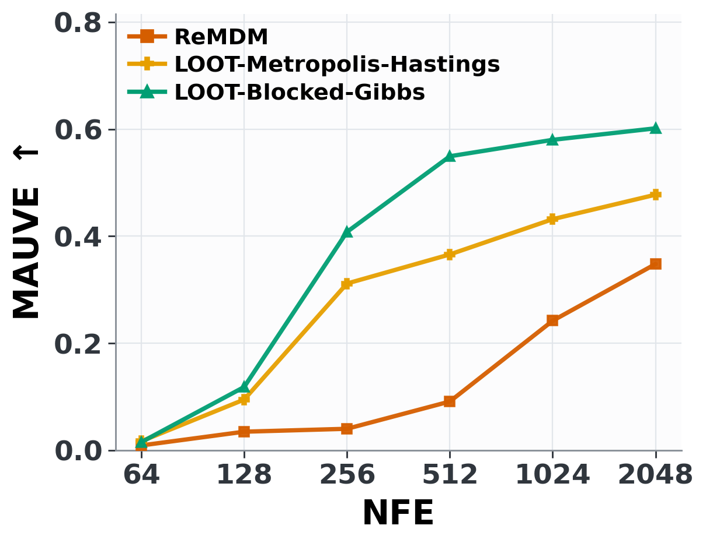
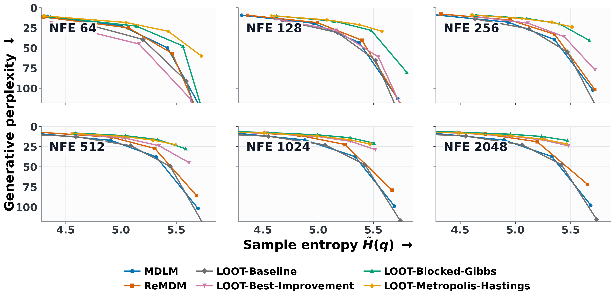

# Empowering Masked Diffusion Models to Self-Correct with Leave-One-Out Transformers

**Sofian Zalouk, Vincent Counathe, Paul Jünger, Daniel Cao, Daniel Zlotnick, Kilian Q. Weinberger, Christopher De Sa**

Department of Computer Science, Cornell University

**Accepted at NeurIPS 2026.**

[](https://openreview.net/forum?id=ic1GS1Kl0Z)
[](https://openreview.net/pdf?id=ic1GS1Kl0Z)
[](#code-release)

> **Code, checkpoints, and sampling scripts will be released in this repository soon.**

## TL;DR

A hollow transformer architecture and training objective that let masked diffusion language models train on every token and self-correct at inference, with a single network acting as both predictor and corrector.

## Abstract

Diffusion models promise iterative refinement, yet masked diffusion language models (MDMs) suffer from two shortcomings: (1) inability to revise tokens, and (2) sparse training signal. The root cause is structural: MDMs control information flow only through input masking, so unmasked positions cannot be supervised, and self-correction is never learned. Building on hollow transformers, we propose the Leave-One-Out Transformer (LOOT), which addresses both issues. With LOOT, MDMs predict the distribution over potential replacements conditioned on the rest of the sequence at each position, in a single forward pass. Supervision can then be applied at masked and unmasked positions alike, yielding a lower-variance training objective with a dense loss signal at every token. Our method empowers MDMs to learn self-correction during training and supports continuous refinement at inference time via Gibbs sampling. LOOT matches the strongest parameter-matched baselines in validation perplexity on LM1B. On OpenWebText, LOOT establishes a generative quality-vs-diversity frontier that surpasses prior remasking methods at a fraction of their inference compute.

## Method

### The leave-one-out property

A standard bidirectional denoiser can see the token it is asked to predict, so visible tokens can never be supervised and never be revised. LOOT's output at position *i* depends on every input token except *x<sub>i</sub>*, which makes every position a valid training target and gives the model a conditional distribution over replacements for every token, masked or not.

<p align="center">
  
</p>

### Architecture

LOOT keeps three streams of hidden states: a left-to-right stream, a right-to-left stream, and an output stream that merges the two at **every layer** while never attending to itself, so the leave-one-out property holds under composition. All three streams share weights, and the merge is a sliding-window attention that runs on unmodified FlashAttention kernels, which is what makes merging at every layer affordable. The parameter count matches a standard diffusion transformer of the same depth and width, and a pretrained MDM checkpoint can initialize all three streams.

<p align="center">
  
</p>

### Training objective

Because the prediction at position *i* does not depend on whether *x<sub>i</sub>* is masked, the per-position masking probability can be marginalized analytically inside the masked-diffusion ELBO. The resulting objective supervises every token with the bounded weight *&alpha;'<sub>t</sub>*, equals the MDLM NELBO in expectation, and has strictly lower variance than both the MDLM objective and the two-term objectives used to train hollow transformers previously.

### Self-correction

One forward pass returns the leave-one-out conditional at every position, which is exactly what classical conditional samplers need. LOOT revises its own samples with blocked Gibbs sampling or a Metropolis-style corrector, with no remasking heuristics and no separate corrector model.

<p align="center">
  
</p>

## Headline results

### Language modeling (validation perplexity, lower is better)

Parameter-matched comparison; LM1B at sequence length 128 for 1M steps, OpenWebText at length 1024 for 250K steps. Mean &plusmn; std over 5 evaluation seeds.

| Method | LM1B | OpenWebText |
|---|---|---|
| MDLM | 31.80 &plusmn; 0.08 | **25.20 &plusmn; 0.02** |
| PGM | 31.04 &plusmn; 0.09 | 26.57 &plusmn; 0.02 |
| **LOOT** | **31.02 &plusmn; 0.04** | 26.83 &plusmn; 0.01 |

On LM1B, LOOT matches PGM and improves over MDLM. At sequence length 1024 a gap to MDLM remains: the cost of the leave-one-out constraint grows with length while the benefit of dense supervision stays roughly constant.

### Self-correction on OpenWebText

Self-correction is where the architecture pays off. On unconditional generation at length 1024, LOOT with self-correction at **256 NFE** matches or exceeds ReMDM at **2048 NFE** across the full quality-diversity frontier, using **8x fewer forward evaluations** and, after accounting for the 2.2x cost of a LOOT forward pass, **3.5x fewer inference FLOPs** and about **8x less wall-clock time per sample**.

<p align="center">
  
  
</p>

Left: generative perplexity against sample entropy over a temperature sweep. Right: MAUVE on 5000 samples per point, under the evaluation protocol of ReMDM. At the entropy of natural text, blocked Gibbs at 256 NFE reaches a generative perplexity of 23.7 against 41.3 for ReMDM at 2048 NFE, and a MAUVE of 0.41 against 0.35.

<p align="center">
  
</p>

Across every budget from 64 to 2048 NFE, LOOT self-correction shifts the frontier outward relative to MDLM, ReMDM, and the uncorrected LOOT sampler.

## Code release

Code, pretrained checkpoints, and the sampling and evaluation scripts are being prepared for release in this repository. Watch or star the repository to be notified.

## Citation

```bibtex
@inproceedings{zalouk2026loot,
  title     = {Empowering Masked Diffusion Models to Self-Correct with Leave-One-Out Transformers},
  author    = {Zalouk, Sofian and Counathe, Vincent and J{\"u}nger, Paul and Cao, Daniel and Zlotnick, Daniel and Weinberger, Kilian Q. and De Sa, Christopher},
  booktitle = {Advances in Neural Information Processing Systems (NeurIPS)},
  year      = {2026}
}
```

## Contact

Sofian Zalouk, saz43@cornell.edu
